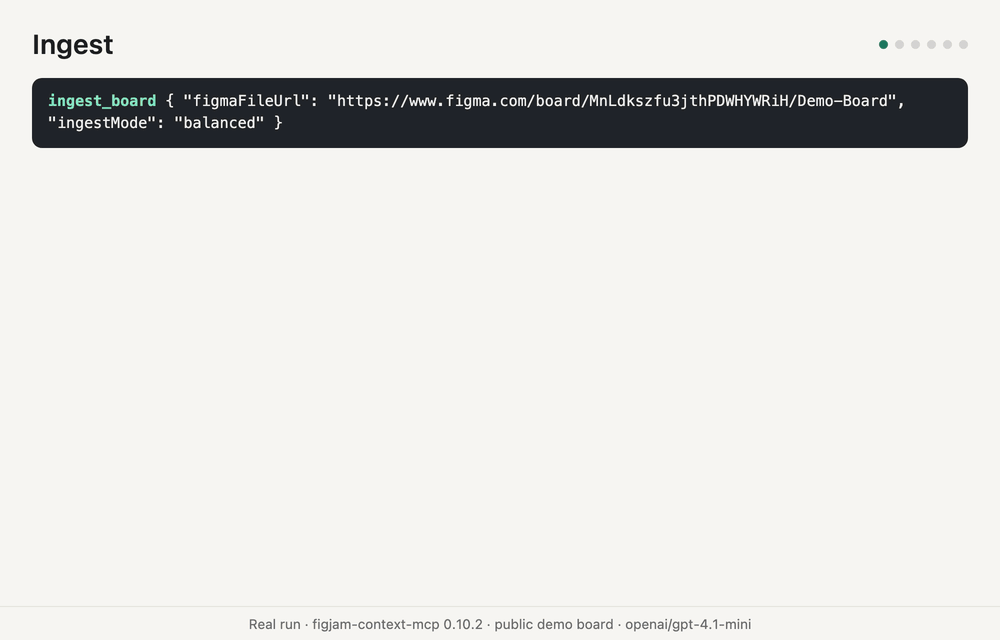
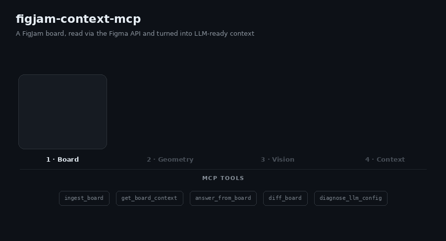

# figjam-context-mcp

A local MCP server that turns FigJam boards into source-cited context for LLMs.
It reads a board through the Figma REST API, groups stickies, tables, images and
arrows into clusters, and answers questions with links back to the original nodes.



Rendered from the tool calls and outputs of a real run against the public
[demo board](https://www.figma.com/board/MnLdkszfu3jthPDWHYWRiH/Demo-Board) with
figjam-context-mcp 0.10.2 and `openai/gpt-4.1-mini`. Figma's MCP server
(`use_figma`) made the edit.

## Why

Workshop boards hold research notes, decisions and open questions, but an LLM
cannot read a canvas. Screenshots and PDF exports lose tables, arrow direction
and the link to the source. This server keeps the board's structure and cites
every answer to the nodes it came from.

## Compared with Figma's MCP server

Figma's official MCP server reads a FigJam board or node with its images
(`get_figjam`) and edits boards (`use_figma`). This server turns a workshop
board into context an assistant can cite and track:

- large boards read section by section, with an overview, size-limited pages and search
- source IDs in compact overviews, with Figma links in full excerpts and answer citations
- tables read row by row
- local snapshots, and `diff_board` to see what changed
- explicit credentials redacted before they reach the cache, the output or a model
- image descriptions from a vision model you configure

The two work together: in the demo above, Figma's server edits the board and
this one reports the change.

## Tools

| Tool | What it does | LLM call |
| --- | --- | --- |
| `ingest_board` | Reads a board, clusters it and saves a local snapshot. Re-ingests reuse unchanged clusters; `focusNodeIds` chooses which sections' images are interpreted first. | In `balanced` (default) and `max_quality` mode |
| `get_board_context` | Reads saved context, automatically using compact source-ID lines for large section reads; `detail: "full"` returns complete excerpts and Figma links. Also supports topic search and pagination. | No |
| `answer_from_board` | Answers one specific question (a number, status or decision) from the most relevant excerpts, with node-level citations or an insufficient-evidence result. Not meant for whole-board summaries. | Yes |
| `diff_board` | Compares snapshots with bounded lists and full totals: clusters, nodes (including moves with origin and destination), table cells (0-based), arrows with source IDs and section/frame renames. Notes unchanged re-ingests. | No |
| `diagnose_llm_config` | Tests the configured models with small text and image JSON checks. | Yes |

`ingest_board` also reads Figma design files (`/design/`, `/file/` and `/proto/`
URLs), but clustering and reading order are made for FigJam boards.

## Quick start

Five steps. Requires Node.js 22.12 or later. Step 4 sets the model provider that
`answer_from_board`, `diagnose_llm_config` and image interpretation need; it is optional.

1. **Node.js.** Check the installed version with `node --version`; install Node.js 22.12
   or later if it is older.
2. **Figma token.** Create a personal access token under **Settings → Security →
   Personal access tokens** with the scope `file_content:read`. The token's account
   must be able to open the board. Every `ingest_board` call is one Figma file
   download, a Tier 1 request. Figma allows View and Collab seats up to 20 Tier 1
   requests a month on every plan, and says the actual limit may be lower
   ([rate limits](https://developers.figma.com/docs/rest-api/rate-limits/)).
3. **Add the server** with the example for your client below. The examples set only
   `FIGMA_ACCESS_TOKEN`, so the server starts and `ingest_board` works in
   `ingestMode: "max_speed"` without a model provider. `@latest` with `--prefer-online`
   makes npx check the registry for the latest release on every start, even when
   package metadata is cached ([npm configuration](https://docs.npmjs.com/cli/v11/using-npm/config#prefer-online)).
4. **Optional: model provider.** Add `LLM_BASE_URL` and `LLM_API_KEY` to the server's
   `env` block, then restart the client. Both are needed together; without them,
   `balanced` ingests run text-only and say that the model settings are missing.
   Example with OpenRouter ([create a key](https://openrouter.ai/keys)):

   ```
   LLM_BASE_URL=https://openrouter.ai/api/v1
   LLM_API_KEY=your-openrouter-key
   ```

   In Claude Code, remove the entry with `claude mcp remove figjam-context` (with the
   same `--scope` as when you added it), then add it again with an `--env` flag for each
   variable ([Claude Code](https://code.claude.com/docs/en/mcp)).
   A local OpenAI-compatible server without sign-in still needs `LLM_API_KEY` set to
   any non-empty value. Set `LLM_TEXT_MODELS`, `LLM_FAST_TEXT_MODELS` and
   `LLM_VISION_MODELS` to its model names ([configuration](https://github.com/ecestnrkl/figjam-mcp/blob/main/docs/configuration.md#models)).
   Then run `diagnose_llm_config` in step 5.
5. **Check the setup.** Ask your assistant to ingest one of your boards with
   `ingestMode: "max_speed"`, for example *"Ingest https://www.figma.com/board/FILE_KEY/Name
   with ingestMode max_speed."* That makes one Figma request and no model call. A
   working setup answers with a line that starts `Ingested board FILE_KEY (snapshot …):`
   and counts the `clusters`. Clients that show their tools, such as Claude Code with
   `/mcp`, list the server there ([Claude Code](https://code.claude.com/docs/en/mcp)).
   With a provider from step 4, also run `diagnose_llm_config`; it checks the configured
   models with small synthetic inputs. For error messages, see
   [common errors](https://github.com/ecestnrkl/figjam-mcp/blob/main/docs/troubleshooting.md#common-errors).

All settings: [configuration](https://github.com/ecestnrkl/figjam-mcp/blob/main/docs/configuration.md).

### Claude Code

```bash
claude mcp add --scope user --env FIGMA_ACCESS_TOKEN=your-figma-token --transport stdio figjam-context -- npx -y --prefer-online figjam-context-mcp@latest
```

`--scope user` makes the server available in all your projects. Without it, Claude
Code stores the server for the current project only ([scopes](https://code.claude.com/docs/en/mcp)).

For longer ingests, set `MCP_TOOL_TIMEOUT=300000` in the environment that launches
Claude Code and `INGEST_BOARD_VISION_BUDGET_MS=270000` in the server environment,
leaving about 30 seconds for the rest of the ingest ([Claude Code environment
variables](https://code.claude.com/docs/en/env-vars)).

### Claude Desktop

Open **Settings → Developer → Edit Config** in Claude Desktop. This opens
`claude_desktop_config.json`; the file is at:

- macOS: `~/Library/Application Support/Claude/claude_desktop_config.json`
- Windows: `%APPDATA%\Claude\claude_desktop_config.json`

Add the server under `mcpServers`, keeping any other entries in the file:

```json
{
  "mcpServers": {
    "figjam-context": {
      "command": "npx",
      "args": ["-y", "--prefer-online", "figjam-context-mcp@latest"],
      "env": {
        "FIGMA_ACCESS_TOKEN": "your-figma-token"
      }
    }
  }
}
```

Then quit Claude Desktop completely and start it again; the server starts with the app
([MCP quickstart](https://modelcontextprotocol.io/docs/develop/connect-local-servers)).
The MCP documentation names no tool timeout setting for Claude Desktop, so keep the
default image budget.

### Codex CLI and ChatGPT desktop app

Add this to `~/.codex/config.toml`; the app, CLI and IDE extension share this
configuration ([OpenAI MCP setup](https://learn.chatgpt.com/docs/extend/mcp#configure-with-configtoml)):

```toml
[mcp_servers.figjam-context-mcp]
enabled = true
command = "npx"
args = ["-y", "--prefer-online", "figjam-context-mcp@latest"]
startup_timeout_sec = 30
default_tools_approval_mode = "approve"

[mcp_servers.figjam-context-mcp.env]
FIGMA_ACCESS_TOKEN = "your-figma-token"
```

Without `default_tools_approval_mode = "approve"`, ChatGPT may ask for approval
or abort tools with external effects; with it, the client never asks before board
content goes to the model provider, so use `max_speed` and avoid `answer_from_board`
for confidential boards.

For longer ingests, set `tool_timeout_sec = 300` under
`[mcp_servers.figjam-context-mcp]` and `INGEST_BOARD_VISION_BUDGET_MS = "270000"` in its
`env` table, leaving about 30 seconds for the rest of the ingest ([OpenAI timeout
options](https://learn.chatgpt.com/docs/extend/mcp#other-configuration-options)).

### GitHub Copilot CLI

Add this to `~/.copilot/mcp-config.json`
([Copilot CLI MCP setup](https://docs.github.com/en/copilot/how-tos/copilot-cli/customize-copilot/add-mcp-servers)):

```json
{
  "mcpServers": {
    "figjam-context": {
      "type": "local",
      "command": "npx",
      "args": ["-y", "--prefer-online", "figjam-context-mcp@latest"],
      "env": {
        "FIGMA_ACCESS_TOKEN": "your-figma-token"
      },
      "tools": ["*"]
    }
  }
}
```

For longer ingests, set `"timeout": 300000` on the server in
`~/.copilot/mcp-config.json` and `"INGEST_BOARD_VISION_BUDGET_MS": "270000"` in its
`env`, leaving about 30 seconds for the rest of the ingest ([tested with a 600000 ms
timeout](https://github.com/microsoft/vscode/issues/343135)).

### VS Code

In the Copilot harness, add the server under **Global → Copilot Global** in
Chat: Open Customizations (Command Palette), then **MCP Servers**. VS Code writes it to
`~/.copilot/mcp-config.json`, the same file as in the Copilot CLI section, in the portable
`mcpServers` format ([VS Code MCP servers](https://code.visualstudio.com/docs/copilot/chat/mcp-servers),
[configuration reference](https://code.visualstudio.com/docs/agents/reference/mcp-configuration)):

```json
{
  "mcpServers": {
    "figjam-context": {
      "type": "local",
      "command": "npx",
      "args": ["-y", "--prefer-online", "figjam-context-mcp@latest"],
      "env": {
        "FIGMA_ACCESS_TOKEN": "your-figma-token"
      },
      "tools": ["*"]
    }
  }
}
```

The portable format has no input variables, so the token is stored in this file. Keep
that file in your user directory and out of any repository.

Local harness only: to keep the token out of the file, open **MCP: Open User
Configuration** and use an input marked `"password": true`. VS Code does not forward
servers that need inputs to Copilot harness sessions, so this works only in the Local
harness ([VS Code MCP configuration](https://code.visualstudio.com/docs/agents/reference/mcp-configuration)):

```json
{
  "inputs": [
    {
      "type": "promptString",
      "id": "figma-token",
      "description": "Figma personal access token (file_content:read)",
      "password": true
    }
  ],
  "servers": {
    "figjam-context": {
      "type": "stdio",
      "command": "npx",
      "args": ["-y", "--prefer-online", "figjam-context-mcp@latest"],
      "env": {
        "FIGMA_ACCESS_TOKEN": "${input:figma-token}"
      }
    }
  }
}
```

Do not put tokens in a `.vscode/mcp.json` in a repository; VS Code's documentation
says not to commit tokens or passwords.

In the Local harness, `"envFile": "${workspaceFolder}/.env"` on the server in `mcp.json`
loads an environment file; the portable format does not support `envFile`, and the
server does not load a working-directory `.env` itself.

For longer ingests, use the Local harness with a per-server `"timeout": 300000` in
`mcp.json` and `"INGEST_BOARD_VISION_BUDGET_MS": "270000"` in its `env` (about 30
seconds below the timeout); [#343135](https://github.com/microsoft/vscode/issues/343135)
reports that remote HTTP tool calls in the Copilot harness, the default in 1.142, ignore
that timeout and stop after about 180 seconds, while the Local harness honors it.

### Other MCP clients

For clients that accept `mcpServers`, add this to their MCP configuration:

```json
{
  "mcpServers": {
    "figjam-context": {
      "command": "npx",
      "args": ["-y", "--prefer-online", "figjam-context-mcp@latest"],
      "env": {
        "FIGMA_ACCESS_TOKEN": "your-figma-token"
      }
    }
  }
}
```

Where the client supports a configurable tool timeout, raise it to about 300 seconds
using its documented setting and set `INGEST_BOARD_VISION_BUDGET_MS=270000` in the
server environment, about 30 seconds below it.
Cursor has no configurable timeout: its IDE allows about 60 minutes, while ACP/CLI calls
stop at 60 seconds even with progress, so keep the default image budget on that path
([Cursor
support](https://forum.cursor.com/t/agent-acp-mcp-tools-call-times-out-at-60s-with-no-way-to-configure-it/163925/5)).

## Using the tools

Then ask your assistant to ingest a board URL, for example *"Ingest
https://www.figma.com/board/FILE_KEY/Name and list the open questions."*
The `boardId` of every later call is the file key from that URL, or the URL
itself; a URL with a `node-id` and without `nodeIds`, `topic` and
`outsideSections` makes `get_board_context` read that node.

Branch URLs use the branch key as the file key; design files can be ingested, but
clustering and reading order are designed for FigJam boards.

To summarize a board, the assistant calls `ingest_board`, then
`get_board_context` without parameters, whose first page names the largest
sections and includes a bounded page/section overview with IDs within the
page's size limit. The section directory may omit empty sections and counts
unlisted pages. The footer gives one reusable read call for the listed page IDs. Read each
page separately with `nodeIds: [pageId]`, `detail: "auto"` and `maxChars: 24000`,
following `nextCursor` with unchanged arguments. Page reads already include
content outside sections, so `outsideSections: true` is only needed for a
separate targeted query. Several IDs in one call take turns in request order,
up to 50 per call.
Large `nodeIds` reads automatically use short source-ID lines, grouped by section,
when the first full page would leave unread excerpts. `limit` applies only with
the full view; an overview ignores it even when supplied. Read complete text and
its Figma link with the same `boardId` and `snapshotId`, the line's ID in
`nodeIds`, and `detail: "full"`. For a table row, use its table ID.
Everything that lies in no section, such as loose notes and tables, comes with
`outsideSections: true`.
Compact overviews show the Figma link pattern for their node IDs (URL-encode the ID)
and shorten each text to a shared 50–120-character prefix with `…`; the host writes
the summary. Topic searches, `outsideSections`, single leaf, table or cell IDs and
small containers always return the full view.

Inputs are read as hosts and users send them. A node ID in link form (`5-87`,
`5%3A87`, `I5-87%3B1-2`) or a Figma link of the same board with a `node-id` is
read as the ID it stands for (`5:87`) in `nodeIds` and `focusNodeIds`, and the
text says so once; an ID that exists in the snapshot is never changed, and a
link of another board is an error. A key that differs from a parameter only in
case, `_` or `-` (`ingest_mode`, `node_ids`) ends the call with
"did you mean …" before anything is done; any other unknown key is ignored and
named, without its value, in the text and in `ignoredArguments` of
`structuredContent`. File keys are case-sensitive: an unknown `boardId` lists
the stored boards (at most 10, most recent first) and names a key that differs
only in case.

## How it works



1. **Read.** `ingest_board` downloads the board through the Figma REST API on
   every call. `get_board_context` and `answer_from_board` read the saved
   snapshot without a new request.
2. **Normalize.** Nodes become text, table cells, images and connectors, with
   their pages, sections and named enclosing frames and groups. Tables are read row by row: row and column come
   from the cell IDs, and each row becomes one excerpt.
3. **Cluster.** Nearby nodes are grouped by rotation-aware distance. Arrows
   between groups become directed relations. Clusters without a model label
   are named after their section, and an arrow appears in the context once one
   of its ends, or a section, frame or group around one, is on the page.
4. **Interpret.** In `balanced` mode, clusters with an image, or drawings without
   any text, get a vision-model summary within a 40-second budget; text clusters,
   however short, keep their extracted text. A cluster starts only when the time
   left fits it; unfinished clusters continue on the next ingest. With
   `focusNodeIds`, the images of the given sections, frames or nodes come first.
   In `max_quality`, one ingest interprets only a few dozen clusters within the
   40-second image budget (20–35 on a board with about 300 clusters, measured
   with 3 parallel requests); the next ingest continues, each costs a Tier 1 file
   download, and `focusNodeIds` sets the order.
5. **Serve.** The snapshot is saved to a private local cache. Search gives more
   weight to excerpts containing the question’s exact words.
   `get_board_context` searches it (BM25 over original text, table rows and
   names, arrow labels and table headings), `answer_from_board` answers with
   citations and `diff_board` compares snapshots. Topic and question searches
   match whole words ignoring case and accents (words of five or more letters
   also match some word forms and compounds), but not synonyms or translations.
   An empty search may suggest similar words from the board; these are not
   matches. Use the board's words and language; an empty search does not prove
   the board lacks the topic. Paging, overviews and the `detail`
   setting are described in [Using the tools](#using-the-tools). Full-view excerpt
   text is quoted with `> ` on every line, and model-generated cluster labels are
   marked as model labels.
   Text `content` is the readable page; `structuredContent` holds each excerpt
   once, in `overview.text` (with empty `evidence` and `clusters`) or in `evidence`
   for the full view. Full excerpts inherit `snapshotId` from the response;
   absent `chunkIndex` means 0 and absent `truncated` or `modelDerived` means
   false, with no inheritance of these flags from a cluster. Named frames and
   groups appear in `frameNames` on clusters and on excerpts whose location
   differs; their names also participate in search.

## Models and cost

The default preset `student-free` uses free OpenRouter models: text and images go
to `openrouter/free`, which picks a free model that supports structured outputs
(and images, for images). The free default is best effort: free models change, hit rate limits
and time out. A request to `openrouter/free` or `openrouter/auto` that fails with
a provider error is sent once more, since the router may pick another model. Images go to the model with at most 1,024 px on the longest side;
larger ones are scaled down locally.

- OpenRouter allows free models 20 requests per minute and 50 requests per day,
  or 1,000 per day once you have bought at least 10 credits
  ([limits](https://openrouter.ai/docs/api-reference/limits)).
- Figma limits requests by seat and plan
  ([rate limits](https://developers.figma.com/docs/rest-api/rate-limits/)). File
  downloads and image renders are Tier 1: Dev and Full seats on paid plans get
  10–20 requests per minute, View and Collab seats and files in Starter plans at
  most 20 per month. Every `ingest_board` call is one file download, so a View or
  Collab seat allows about 20 ingests a month. Images come from the image fills instead, Tier 2 with at
  least 5 requests per minute, in one request per ingest. Renders are left for
  drawings without an image and as a fallback for images without a usable original;
  renders of several clusters share requests of up to 18 nodes, so 30 image clusters
  without image fills need 2 render requests. `max_speed` needs neither.
- `LLM_BASE_URL` takes any OpenAI-compatible endpoint; for paid models, set
  `LLM_TEXT_MODELS`, `LLM_FAST_TEXT_MODELS` and `LLM_VISION_MODELS`, for example
  all three to `openai/gpt-4.1-mini` (provider charges apply).
- Run `diagnose_llm_config` after every model change. It checks JSON replies
  and image understanding with synthetic inputs.

## Privacy

- The server reads from Figma and never changes a board.
- Hidden elements and their descendants are skipped before extraction, image loading and provider requests; contents hidden inside a FigJam section are skipped too.
- URL passwords in userinfo are redacted alongside other explicit credentials.
- `balanced` and `max_quality` ingests send board text and images (originals or
  renders) to the configured LLM provider. `answer_from_board` sends the question and selected
  excerpts. `max_speed` with `get_board_context` and `diff_board` sends nothing
  to an LLM provider.
- Snapshots stay in a private per-user cache on your machine. Delete the cache
  directory to remove them.
- Explicit credentials such as `Passwort: …` or API keys are redacted before they
  reach the cache, tool output or an LLM provider
  ([`FIGJAM_MCP_REDACT_CREDENTIALS`](docs/configuration.md#privacy)). This is a
  safety net, not a guarantee: images are not redacted, so keep credentials
  off the board.
- Keep tokens in the client's environment. A token passed as a tool argument can
  appear in client logs.

## Limitations

- Image interpretation gets 40 seconds per ingest by default; large boards need
  several ingests to interpret every image cluster.
- A client that cancels an ingest, for example after a 60-second timeout, gets
  no partial result.
- Free models are best effort. Citations show where an answer comes from, not
  that its conclusion is right.
- Search is lexical; some word forms and compounds match, but synonyms and
  translations do not.
- Local stdio only; no hosted or multi-user mode.

Measured results: [evaluation](https://github.com/ecestnrkl/figjam-mcp/blob/main/docs/evaluation.md).

## Development

```bash
git clone https://github.com/ecestnrkl/figjam-mcp.git
cd figjam-mcp
npm ci
cp .env.example .env    # optional: add tokens for local development
npm run check           # typecheck, tests, build, package validation
npm run package:smoke   # install the packed package and exercise all tools
npm run eval:retrieval  # offline retrieval and diff evaluation
npx --prefer-online @modelcontextprotocol/inspector --config inspector.config.json
```

`npm run dev` and `inspector.config.json` explicitly load the repository's `.env`
with Node's `--env-file-if-exists=.env`; existing environment values win. For other
launch commands, configure the MCP client's `env` or set `FIGJAM_MCP_ENV_FILE` to
the absolute path of the file.

See [CONTRIBUTING.md](https://github.com/ecestnrkl/figjam-mcp/blob/main/CONTRIBUTING.md)
and the [changelog](https://github.com/ecestnrkl/figjam-mcp/blob/main/CHANGELOG.md).

## License

[MIT](https://github.com/ecestnrkl/figjam-mcp/blob/main/LICENSE) © 2026 ecestnrkl
